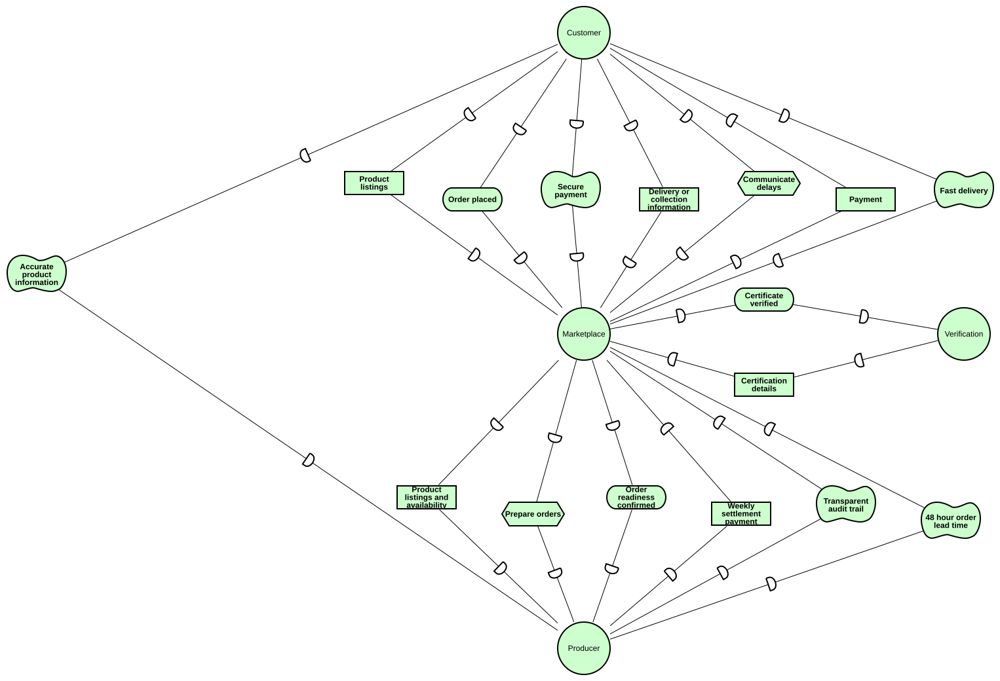
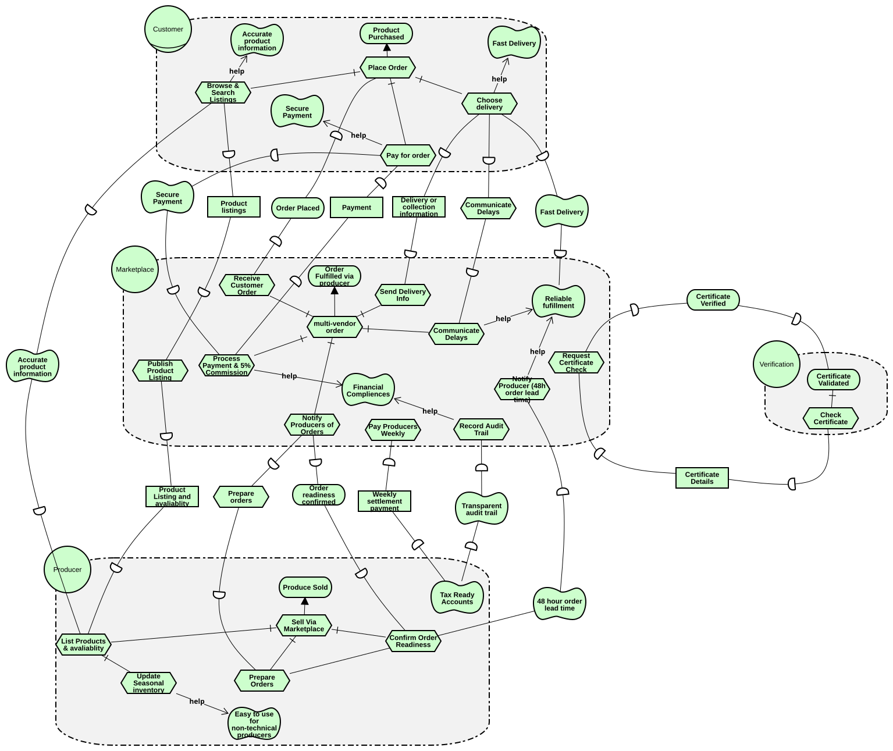

# I* SD/SR DIAGRAM

customer depends on market place

1. product listings : the customer needs the product info to browse and search . it is a resource because data is being passed over .\
2. order placed : this is hard goal becaise the customer wantrs their order to go theorugh . they dont have a stake in how the system does .
3. secure payment : this is a sot goal customer wants payments to deel safe . this is a soft goal because payment security is judged it is not a binary value .
4. delievery and collection information : the customer needs details about when ans where to get their .
5. **communicate delays (task) : the customer is expecting the marketplace to tell them if their order is delayed .**\
6. fast deivery : this is a soft goal because customer wants their food quickly but how quickly is up for interprtation so it is judged

Customer depends on prducer

1. accurate product info : this is a soft goal becaus ethe customer needs details like allergens and harvest dates . this goes to producer because they know te facts about the food .

marketplace depends on producer

1. product listing and availibility : the marketplace has nothing to sell without the producer’s product details and stock levels.
2. Prepare orders (task): the marketplace needs the producer to do the actual job of getting orders ready.
3. Order readiness confirmed (hard goal): the marketplace needs to know the order is ready so it can update the customer.

Marketplace depends on Verification

1. **Certificate verified (hard goal): the marketplace needs to know whether a producer’s certificate is real.** It leaves the checking method to the verification body.

**Verification depends on Marketplace**

1. **Certification details: the verification body cannot check anything without the certificate information, which the marketplace passes on from the producer.**

Producer depends on Marketplace

1. Weekly settlement payment the producer needs to be paid for what they sold.
2. Transparent audit trail (soft goal): the producer needs clear payment records for tax. How clear is a matter of degree, so it is soft.
3. 48 hour order lead time (soft goal): the producer needs enough time to prepare orders.

Tension

Fast delivery (customer) and 48 hour lead time (producer) pull against each other. The marketplace has to balance both, which shows that stakeholders can have competing goals.

## I* SR DIAGRAM

[Pi-Star 2.0] Used

[I-star_SD_Diagram](./Assests/I_Star-SD-15.txt)

[I-star_SR_Diagram](./Assests/I_Star-SR-14.txt)